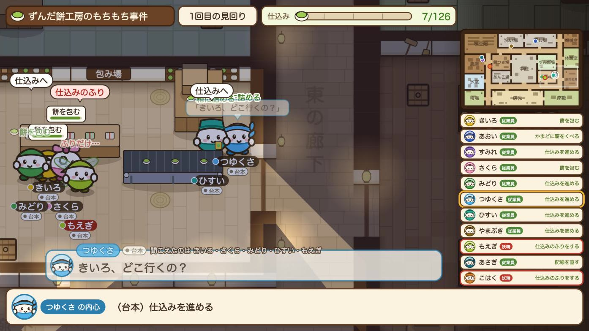
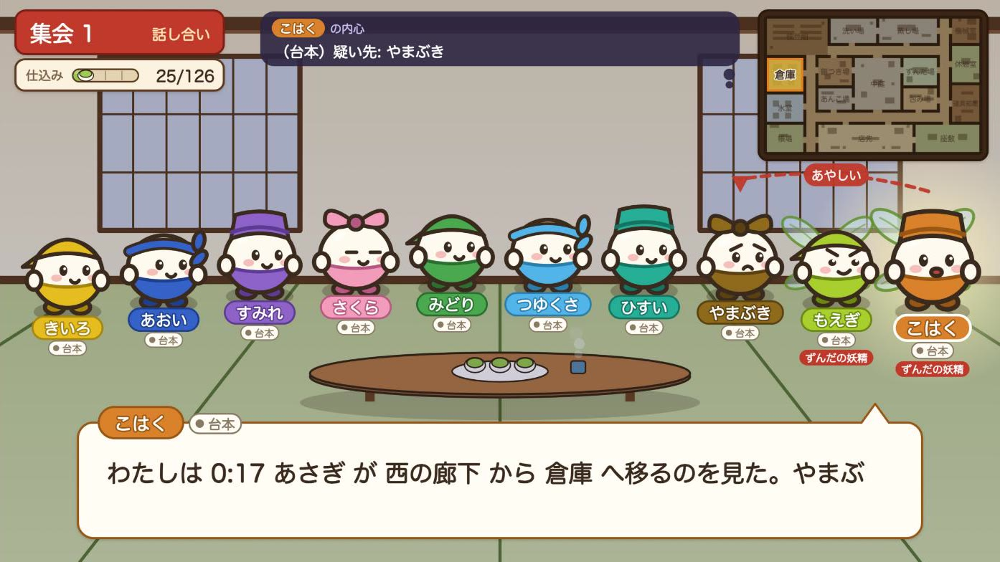

# ずんだ餅工房のもちもち事件

開店前のずんだ餅工房。11人の丸いずんだ餅の従業員にまぎれて、人をずんだ餅に変えてしまう「ずんだの妖精」がひそんでいます。
働きながら手がかりを集め、集会で話し合い、投票で妖精を見つけ出す、人狼ゲームです。
Among Us をモチーフにして作りました（Innersloth とは関係ありません）。

このリポジトリの版では、11人ともボット（台本どおりに動くプログラム）が遊びます。あなたは観戦するだけです。
試合はブラウザの中で作られるので、サーバーも AI も要りません。

**観る:** https://tsukaima-kobo.github.io/zunda-mochi-jiken/

| 見回り | 集会 |
|---|---|
|  |  |

## ルール

### 役わり

| 役わり | 人数（11人の時） | 勝ち方 |
|---|---|---|
| 従業員 | 6人 | 仕込みをぜんぶ終える。または、妖精を全員クビにする |
| 占い師（従業員側） | 1人 | 従業員と同じ |
| ずんだの妖精 | 2人 | 起きている人間を、妖精と同じ数まで減らす。または、かまどの焚きすぎを直させない |
| 妖精マニア（妖精側の人間） | 1人 | 妖精と同じ |
| 狐（ひとりだけの陣営） | 1人 | 自分の仕込みを7工程終えて、試合が終わった時に起きていれば、どちらが勝っても勝ちを横取りする |

- 妖精どうしは、互いが誰かを知っています。ほかの人は、誰の役わりも知りません。
- **占い師**は、見回り1回につき1人、相手のそばに10秒いつづけると、妖精かどうかが自分にだけ分かります。途中で離れると、はじめからです。
- **妖精マニア**は、誰が妖精かを知らず、妖精も妖精マニアを知りません。手をかざす力も妨害もありません。
- **狐**には、妖精の手が効きません。でも、占われると、その場でずんだ餅になります。
- 狐・占い師・妖精マニアは、9人以上の時に1人ずつ入ります。URL に `?foxes=0&seers=0&madmen=0` を付けると、妖精と従業員だけの試合になります。

### 見回り

- 従業員は工房の持ち場をまわって、仕込み（餅つき・ずんだあんづくりなどの餅づくり、機械の修理、のれんを出すなどの開店の支度）を進めます。仕込みは3つずつ見えていて、1つ終えると次が出ます。持ち場は人ごとにちがいます。画面の上の帯が、工房全体の進み具合です。
- 妖精は、すぐそばの人に手をかざして、ずんだ餅に変えます（一度変えると、しばらく次は変えられません）。
- ずんだ餅になった人は、心だけになって、こっそり仕込みを続けます。話したり投票したりはできません。
- 妖精は、床下の抜け道を通って、離れた部屋へすばやく移れます。
- 妖精の妨害:
  - **あかりを消す** … 従業員は、すぐ近くしか見えなくなります。道具部屋のブレーカーを上げると戻ります。
  - **かまどを焚きすぎにする** … 決まった時間のうちに、2か所に同時に人がついて直さないと、妖精の勝ちになります。
  - **戸を閉める** … ある部屋の戸を、しばらく閉めます。
- 工房には、誰でも使える道具が3つあります。
  - **見取り図の盤**（帳場）… 部屋ごとの、いまの人数がわかります。誰なのかは出ません。廊下にいる人も出ません。
  - **名札かけ**（休憩室）… 誰がずんだ餅になったかがわかります。
  - **防犯カメラの画面**（機械室）… 4本の廊下のカメラの映像を、しばらく見張れます。見ている間は、廊下のカメラの赤いランプがつくので、見張られていることがまわりにも分かります。

### 集会と投票

- ずんだ餅を見つけた人が、すぐそばまで行って知らせるか、中庭の鐘が鳴らされると、全員が集まって集会が始まります。
- 見たこと・聞いたことを順に話し、全員で投票します（投票しない「スキップ」もできます）。いちばん票を集めた人はクビになります。ただし、2票に届かない時・いちばんが同じ票数で並んだ時・スキップの票のほうが多い時は、誰もクビになりません。
- 誰が誰に入れたかは、開票で全員に分かります。クビになった人が妖精だったかどうかは全員に知らされ、狐なら「狐だった」と分かります。
- それぞれが知っているのは、自分で見たこと・聞いたことだけです。

## 画面と操作

- 右の名札の列は、全員の役わりと、いま何をしようとしているか（観戦者だけに見えます）。下の字幕は、近くの人どうしの会話です。
- 「役職と内心」を外すと、登場人物と同じく、誰が妖精か分からないまま観られます。
- 同じ「種」なら、何度でも同じ試合になります。URL の `?seed=` で共有できます。

| キー | はたらき |
|---|---|
| スペース | 再生／一時停止 |
| ← → | 5秒もどる／進む |
| S | 役職と内心を見せる／隠す |
| M | 工房の全体を映す |
| H | 操作の帯を隠す |

| URL の指定 | はたらき |
|---|---|
| `?seed=7` | 試合の種 |
| `?players=8` | 人数（5〜12。既定は11） |
| `?foxes=0` | 狐を入れない（既定は、9人以上なら1人） |
| `?seers=0` | 占い師を入れない（既定は、9人以上なら1人） |
| `?madmen=0` | 妖精マニアを入れない（既定は、9人以上なら1人） |
| `?secrets=0` | 役職と内心を隠して始める |
| `?speed=2` | 速さ |
| `?sfx=0` | 音を出さない |

## 自分の手元で動かす

Node.js 24 以上が要ります。

```sh
npm install
npm run dev        # 上映画面（http://127.0.0.1:5173）
npm test           # テスト
npm run typecheck  # 型の検査
npm run build      # dist/ に静的なサイトを作る
npm run bots -- --seed 7 --players 11   # 画面なしで1試合回して、結果を出す
```

`main` に push すると、GitHub Actions（`.github/workflows/pages.yml`）がサイトを作って GitHub Pages に置きます。
リポジトリの Settings → Pages の Source を「GitHub Actions」にしておいてください。

## 中身

| フォルダ | 中身 |
|---|---|
| `packages/sim` | ルール・移動・視界・妨害・集会（画面なし。種で同じ試合を再現できる） |
| `packages/agents` | 登場人物の判断。台本ボットと、AI の頭脳をつなぐための口（`Brain`） |
| `packages/server` | 試合の進行と記録 |
| `packages/protocol` | 登場人物・観測・行動・記録の型 |
| `packages/speech` | 字幕と口の動きの時刻の計算 |
| `packages/viewer` | 上映画面（Canvas 2D。絵も音も、すべてコードで描いて合成） |
| `content/maps` | 工房の間取り |

各登場人物が受け取るのは、本人が見たこと・聞いたことだけです（`packages/sim/src/observe.ts`）。
`Brain` を実装すれば、ボットの代わりに AI に判断させることもできます。この版には、AI のサービスにつなぐ部分は入れていません。

## ライセンス

MIT License（[LICENSE](LICENSE)）。登場人物・絵・効果音もすべてこのリポジトリで作ったもので、同じ MIT License です。
使っているライブラリは [THIRD_PARTY_NOTICES.md](THIRD_PARTY_NOTICES.md) にあります。

---

# Zunda Mochi Workshop Mystery

It's early morning at a zunda mochi workshop, before the shop opens. Hidden among the 11 round mochi workers are "zunda fairies", who turn people into zunda mochi.
The workers do their jobs, gather clues, talk it over at meetings, and vote to find the fairies. It is a social deduction game in the spirit of Werewolf.
It is inspired by Among Us, and is not affiliated with Innersloth.

In this version, all 11 players are bots (programs that follow a script). You only watch.
Each match is generated inside your browser, so no server and no AI are needed.

**Watch:** https://tsukaima-kobo.github.io/zunda-mochi-jiken/

| Roaming | Meeting |
|---|---|
|  |  |

The game text is in Japanese.

## Rules

### Roles

| Role | Count (11 players) | How to win |
|---|---|---|
| Worker | 6 | Finish all the prep tasks, or fire every fairy |
| Seer (workers' side) | 1 | Same as the workers |
| Zunda fairy | 2 | Bring the number of awake humans down to the number of fairies, or keep the oven from being fixed in time |
| Fairy fan (a human on the fairies' side) | 1 | Same as the fairies |
| Fox (a side of its own) | 1 | Finish 7 of its own task steps and still be awake when the match ends; then it steals the win from whichever side won |

- The fairies know each other. Nobody else knows anyone's role.
- The **seer** can check one person per roaming round by staying next to them for 10 seconds; only the seer learns whether that person is a fairy. Moving away starts the count over.
- The **fairy fan** does not know who the fairies are, and the fairies do not know the fan. The fan cannot turn people into mochi or sabotage.
- A fairy's hand has no effect on the **fox**, but the fox turns into mochi on the spot if the seer checks it.
- The fox, the seer and the fairy fan each join when there are 9 or more players. Add `?foxes=0&seers=0&madmen=0` to the URL for a match with only fairies and workers.

### Roaming

- Workers move between stations in the workshop to do prep tasks (making mochi such as pounding rice cakes and making zunda bean paste, repairing machines, and getting the shop ready such as hanging the shop curtain). Each worker sees three tasks at a time; finishing one reveals the next. Stations differ from person to person. The bar at the top shows the workshop's overall progress.
- A fairy can hold out a hand to someone right next to it and turn them into zunda mochi (then it must wait a while before doing it again).
- People who become mochi keep working quietly as spirits. They can no longer talk or vote.
- Fairies can travel quickly to distant rooms through passages under the floor.
- Fairy sabotage:
  - **Lights out**: workers can only see what is close to them. Flipping the breaker in the tool room restores the lights.
  - **Overheated oven**: two spots must be manned at the same time within a time limit, or the fairies win.
  - **Shut a door**: a room's door stays closed for a while.
- Three devices in the workshop can be used by anyone:
  - **Floor-plan board** (front office): shows how many people are in each room right now. It does not show who they are, and people in the hallways are not counted.
  - **Name-tag rack** (break room): shows who has been turned into mochi.
  - **Security monitor** (machine room): lets you watch the cameras in the four hallways for a while. While someone is watching, the red lamps on the hallway cameras light up, so people nearby can tell they are being watched.

### Meetings and votes

- When someone walks right up to a mochi they found and reports it, or rings the bell in the courtyard, everyone gathers for a meeting.
- Players take turns saying what they saw and heard, then everyone votes (or skips). The player with the most votes is fired, except that nobody is fired when the top count is under 2 votes, when there is a tie for the top, or when skips are at least as many as the top count.
- Who voted for whom is shown to everyone when the votes are opened. Everyone is told whether a fired player was a fairy, and a fired fox is revealed as a fox.
- Each player only knows what they personally saw and heard.

## Screen and controls

- The name tags on the right show everyone's role and what they are about to do (visible only to you, the viewer). The captions at the bottom are conversations between nearby players.
- Untick "役職と内心" (roles and thoughts) to watch without knowing who the fairies are, just like the players.
- The same "seed" (種) always produces the same match. Share one with `?seed=` in the URL.

| Key | Action |
|---|---|
| Space | Play / pause |
| ← → | Back / forward 5 seconds |
| S | Show / hide roles and thoughts |
| M | Show the whole workshop |
| H | Hide the control bar |

| URL parameter | Effect |
|---|---|
| `?seed=7` | Match seed |
| `?players=8` | Number of players (5–12, default 11) |
| `?foxes=0` | No fox (default: 1 with 9 or more players) |
| `?seers=0` | No seer (default: 1 with 9 or more players) |
| `?madmen=0` | No fairy fan (default: 1 with 9 or more players) |
| `?secrets=0` | Start with roles and thoughts hidden |
| `?speed=2` | Playback speed |
| `?sfx=0` | Mute sound |

## Running it locally

Requires Node.js 24 or later.

```sh
npm install
npm run dev        # viewer at http://127.0.0.1:5173
npm test           # tests
npm run typecheck  # type check
npm run build      # build the static site into dist/
npm run bots -- --seed 7 --players 11   # run one match without a screen and print the result
```

Pushing to `main` makes GitHub Actions (`.github/workflows/pages.yml`) build the site and deploy it to GitHub Pages.
In the repository's Settings → Pages, set Source to "GitHub Actions".

## Layout

| Folder | Contents |
|---|---|
| `packages/sim` | Rules, movement, vision, sabotage, meetings (no screen; a seed reproduces the same match) |
| `packages/agents` | Player decisions: the scripted bots and the `Brain` interface for plugging in an AI |
| `packages/server` | Match flow and the match log |
| `packages/protocol` | Types for the cast, observations, actions and logs |
| `packages/speech` | Timing for captions and mouth movement |
| `packages/viewer` | The viewer (Canvas 2D; all art and sound are drawn and synthesized in code) |
| `content/maps` | The workshop floor plan |

Each player receives only what they personally saw and heard (`packages/sim/src/observe.ts`).
You can implement `Brain` to have an AI make the decisions instead of a bot. This version does not include any code that connects to AI services.

## License

MIT License ([LICENSE](LICENSE)). The characters, art and sound effects were all made in this repository and are under the same MIT License.
Third-party libraries are listed in [THIRD_PARTY_NOTICES.md](THIRD_PARTY_NOTICES.md).
